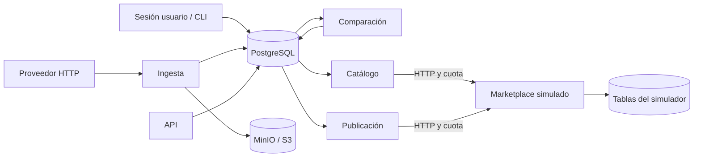

# SRD: Ivo Stock

El [PRD](../prd/PRD.md) define el alcance y sus IDs. Este documento especifica implementación y comprobación. Los comandos están en el [README](../../README.md).

## Arquitectura

Patrón: servicios independientes integrados por eventos y una cola durable. Ingesta, comparación y publicación son procesos separados que no se llaman entre sí. La aceptación de una corrida registra un evento de comparación; el comparador lo consume y encola una tarea por vínculo con diferencia; el publicador toma las tareas y escribe en el marketplace respetando la cuota. Eventos y cola viven en PostgreSQL ([ADR-0002](../adr/0002-postgresql-compartido.md), [ADR-0004](../adr/0004-cola-postgresql.md)). Así la ingesta no conoce vínculos, una tienda lenta no frena la lectura de proveedores y un proceso caído retoma el trabajo persistido.

Python 3.12, FastAPI, SQLAlchemy, Alembic, psycopg, httpx y boto3. Las dependencias se bloquean en `uv.lock`. API y workers comparten PostgreSQL; no se llaman entre sí. Sus caídas son independientes mientras PostgreSQL esté disponible. El simulador persiste en tablas propias y el motor sólo lo consulta por HTTP.

La sesión `ivostock.usuario` y la CLI acceden a los servicios mediante `ivostock.services`. La sesión imita las acciones del futuro frontend: exige el login de demostración y sólo expone comandos de usuario; los comandos de ensayo y operación (`fault`, `schedule-now`, `monitor`, `compare`, `publish`) quedan en la CLI de backend. La ingesta reside en `ivostock.ingesta.servicio`, el parser y la guarda en `ivostock.ingesta`, la comparación en `ivostock.comparison`, el publicador en `ivostock.publisher` y el catálogo HTTP en `ivostock.marketplace`. El POC no expone operaciones de configuración por la API; su endpoint es `GET /health`. La interfaz autenticada corresponde al MVP.

## Persistencia y transacciones

| Entidad | Responsabilidad |
|---|---|
| providers, provider_preview | Configuración, próxima ingesta y SKU de la validación del alta |
| stores, catalog | Estado, punto de control de importación (`import_offset`, `import_total`, `import_finished_at`) y catálogo importado |
| runs, stock | Snapshot, resultado y último inventario completo aceptado |
| links | Asignación, confirmado inicial, deseado, confirmado, revisión, corte y estado |
| comparison_events | Aviso durable creado en el commit de aceptación |
| tasks | Una pendiente por vínculo; antigüedad, valor, revisión, backoff y lease |
| attempts, dead_letters | Evidencia de cada envío y fallas que requieren revisión |
| market_calls | Ventana móvil de permisos por tienda |
| worker_heartbeats | Actividad reciente de cada proceso |
| sim_* | Catálogo, cantidades, cuota y fallas del simulador |

Alembic instala el esquema. Un índice único parcial sobre publicación/tienda impide más de un vínculo no desactivado. Las cantidades son enteros entre 0 y 2.147.483.647. Los SKU son cadenas. Los snapshots usan claves SHA-256 y escritura condicional: los bytes de una clave existente no se reemplazan. Tareas e intentos conservan la referencia de corrida; un corte o una reanudación manual puede tener referencia nula y se identifica por vínculo y revisión.

La ingesta adquiere un advisory lock de sesión por proveedor, descarga, almacena el snapshot y registra su referencia. Después normaliza y evalúa el inventario. El reemplazo de stock, resultado aceptado y evento de comparación comparten una transacción. Se usa una tabla temporal con COPY y ANALYZE; sólo se actualizan cantidades distintas y los ausentes se eliminan mediante anti-join indexado. Un snapshot almacenado sin aceptación no cambia stock ni genera tareas. La siguiente corrida identifica registros abandonados como interrumpidos.

Una descarga idéntica al último snapshot aceptado reutiliza el inventario vigente; registra la corrida y conserva un evento durable de comparación. La guarda se calcula cuando cambia el snapshot. Los descartes de duplicados identifican la ocurrencia sustituida y nunca la fila ganadora.

La programación persiste `next_run_at`. El alta lo fija 300 minutos después de la validación; `schedule-now` lo deja vencido sin ejecutar nada, y el worker corre la ingesta por el circuito normal. Una ejecución automática vencida lo adelanta 300 minutos; una manual no lo modifica.

La validación del alta descarga la fuente, aplica RF-11 y guarda sus SKU en `provider_preview`. No es una corrida: no crea snapshot, inventario vigente ni evento de comparación. Las sugerencias usan la última corrida aceptada o, mientras no exista, esa vista previa. Un vínculo aprobado antes de la primera corrida se crea con deseado igual al confirmado del catálogo, así que no genera tareas; la primera corrida aceptada emite el evento que lo compara.

La importación de catálogo corre en el worker `catalog`, una página de hasta cien publicaciones por ciclo. Las publicaciones de la página y el nuevo `import_offset` se confirman en la misma transacción; si el proceso cae antes, la página se vuelve a pedir y `ON CONFLICT DO NOTHING` evita duplicados. Un 429 respeta `Retry-After`; 5xx o una caída de PostgreSQL se reintentan; 401 o 403 degradan la tienda y la reintentan a los treinta segundos. `store-add --wait` ejecuta la misma importación en el proceso de la CLI. El lock evita solapamientos. Una corrida automática interrumpida se recupera mediante el tratamiento de corridas abandonadas antes de esperar el siguiente vencimiento.

El comparador toma el mismo lock por proveedor. Lee su inventario vigente y los vínculos, actualiza deseados y encola diferencias, marcando eventos procesados en la misma transacción. Los vínculos en falla actualizan su deseado pero no vuelven a encolarse solos. Los cortes conservan deseado cero aunque una ingesta posterior tenga cantidad positiva.

## Cola y concurrencia

Las tareas disponibles se eligen por `enqueued_at, link_id`. El reemplazo conserva la fecha original e incrementa su contador; una nueva cantidad recibe una nueva revisión. Las tareas en backoff no impiden elegir otras disponibles. Una tarea en vuelo no se borra al cambiar el deseado.

Un lock de sesión por tienda serializa importación y publicación. El claim persiste revisión y lease antes del HTTP. El lease normal es de treinta segundos, mayor que el timeout HTTP de diez segundos del simulador controlado. Al caer un proceso, PostgreSQL libera su lock y otro puede recuperar la tarea cuando vence el lease. La campaña usa un lease de un segundo con peticiones pequeñas controladas.

La respuesta se confirma en una transacción con el vínculo bloqueado. Siempre se registra el valor realmente confirmado; sólo se retira la tarea si corresponde a la revisión enviada. Si apareció otra revisión, permanece pendiente. Una confirmación de cero sólo desactiva cuando corresponde a la intención vigente. Esta garantía se evalúa frente al simulador del proyecto, no frente a un servidor que difiera escrituras arbitrariamente después del timeout.

Una caída puede repetir una petición aceptada pero no confirmada localmente. La cantidad absoluta hace idempotente el efecto; la evidencia distingue intentos de efectos finales. La conservación se mide sobre trabajo vigente y registra reemplazos deliberados.

## Cuota y errores

Cada permiso de negocio se registra antes del HTTP en PostgreSQL. Un advisory lock transaccional por tienda protege limpieza, conteo e inserción de la ventana móvil de sesenta segundos. Se conceden como máximo sesenta permisos. Un permiso desperdiciado por una caída no se recupera anticipadamente. El simulador tiene un contador independiente para comprobar al cliente.

| Resultado | Tratamiento |
|---|---|
| 200 | Confirmar cantidad y fecha; completar revisión o conservar su reemplazo |
| 429 | Esperar `Retry-After` en segundos; conservar tarea sin gastar intentos de error |
| Sin conexión, timeout, 401 o 403 | Tienda degradada; conservar pendientes y probar acceso después de treinta segundos |
| 5xx | Hasta cinco intentos, con esperas de 5, 10, 20 y 40 segundos |
| Definitivo o agotado | Dead letter y vínculo en falla; reanudación explícita |

La CLI reanuda con el inventario actual, respetando un corte. Marca la revisión humana de las fallas sin borrarlas. Una falla de fuente congela esa fuente; la cuarentena tampoco convierte por sí sola la oferta a cero.

## Contratos HTTP y operación

El contrato del proveedor es RF-11. La preparación agrega exactamente los bytes `SKU;stock\n` al original, conserva procedencia y hashes y sirve únicamente el directorio de derivados. Las credenciales se configuran por entorno; las URLs no deben incluir secretos.

| Endpoint del simulador | Contrato |
|---|---|
| `GET /stores/{store}/items` | Bearer preconfigurado; `limit` entero de 1 a 100 (por defecto 100) y `offset` entero desde 0 (por defecto 0). Ordena por ID de publicación; devuelve `items`, `next_offset` (`null` al terminar) y `total` |
| `PUT /stores/{store}/items/{item}/stock` | Bearer; JSON `available_quantity` entero no negativo; cantidad absoluta |
| `POST /admin/seed` | Credencial de control; crea catálogo una vez por tienda. `store-add` lo usa con una muestra del 50 % de los SKU distintos del inventario configurado, con stock cero |
| `POST /admin/fault` | Credencial de control; estado HTTP e intentos afectados, por tienda o publicación |
| `GET /admin/stores/{store}` | Observación externa de ensayos, sin consumir cuota de negocio |
| `GET /admin/stores/{store}/summary` | Existencia, publicaciones y llamadas de negocio de los últimos sesenta segundos, sin consumir cuota |
| `GET /health` | Disponibilidad de proceso y esquema, sin datos de negocio |

El proveedor de ensayo (`ivostock.proveedor`, puerto 8081) sirve los archivos de `data/feeds`. En cada `GET /{archivo}.csv` elige el 40 % de las filas y permuta entre ellas sus cantidades positivas; los ceros, el orden y el archivo base no cambian. `?no-changes=true` devuelve los bytes archivados. Como no hay SKU ausentes ni ceros nuevos, las variantes no activan la guarda.

El cero se observa como `out_of_stock`; una cantidad positiva como `active`. Los controles administrativos nunca son usados por el publicador. Las lecturas por la API de negocio sí consumen cuota. OpenAPI se obtiene de `/openapi.json` de cada aplicación.

La CLI devuelve JSON y códigos de salida no nulos para errores. `monitor` reúne por tienda las llamadas de los últimos sesenta segundos según el cliente (`market_calls`) y según el simulador, el progreso del catálogo, los contadores de vínculos y los intentos por estado y código HTTP; con `--watch` repite la consulta y sobrevive a una caída de PostgreSQL. Los registros no imprimen URL, tokens ni excepciones HTTP con credenciales. Cada corrida puede seguirse mediante su proveedor, evento, vínculo, revisión e intento.

El generador `ivostock.generador.feeds` produce escenarios sintéticos con semilla y manifiesto de parámetros/hashes; no modifica el inventario usado como base. Los logs de ingesta se formatean mediante `ivostock.logs`: mantienen contexto operativo y omiten el mensaje y traceback de excepciones externas. La CLI conserva su resultado JSON en stdout y envía estos diagnósticos a stderr.

## Protocolos de verificación

Las pruebas unitarias cubren RF-11 a RF-14. La integración usa un PostgreSQL real separado, `ivostock_test`, un bucket `snapshots-test`, servidor HTTP de feeds y simulador por TCP. Cubre RF-05 a RF-24 y RNF-03 a RNF-06, incluidas la reanudación del catálogo tras matar su worker, la aprobación previa a la primera corrida, la baja de proveedor (RF-20), la fuente inaccesible (RF-23) y la tienda con credencial revocada (RF-24). Cada prueba limpia únicamente su base de ensayo.

La campaña de diez cierres mata procesos externos después de observar un marcador: snapshot durable, modificación sin commit, aceptación confirmada, evento tomado, encolado sin commit, comparación confirmada, tarea tomada, HTTP respondido, confirmación sin commit y corte persistido. Se recupera por los comandos normales y se compara el stock externo con el trabajo vigente, incluyendo ceros. Las fallas de aplicación no justifican dead letters en esa campaña. La caída abrupta del servicio PostgreSQL se verifica además con su volumen conservado.

Para RNF-01 se mide desde descarga hasta comparación confirmada con el feed real completo. Para RNF-02 se registra aceptación/corte y efecto en el observador del simulador, con servicios sanos y sin cola previa; cada ensayo informa cantidad y frecuencia de cambios, lecturas y reintentos. No existe un cupo de deltas.

Para RNF-07 se observa durante veinticuatro horas, cada sesenta segundos y por separado: página y consulta autenticada en hasta cinco segundos; cambio pequeño en feed de control, ingesta por CLI y efecto externo en hasta sesenta segundos. La carga es controlada. Los disparos de sonda no cambian la programación de cinco horas, que se prueba por separado. Fallos, sondas faltantes, timeouts y reinicios propios cuentan como indisponibilidad. Las fallas externas se registran aparte. La campaña de cierres se realiza fuera de esa ventana.

Para RNF-09 se programan 9.000 consultas: cinco operadores durante treinta minutos, 50 % listados paginados de hasta cien vínculos, 25 % búsqueda de SKU y 25 % corridas/fallas. Se mide desde el cliente con motor activo, recursos declarados y sin ocultar errores. Las pruebas largas, la interfaz y ML son hitos del MVP, según el [roadmap](../roadmap/ROADMAP.md).
